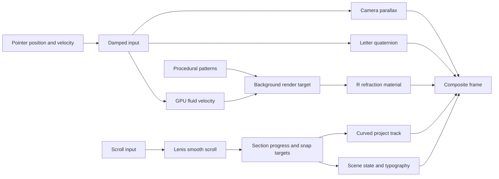

# Alche Studio: visual and technical archive

Audited **4 October 2026** against [alche.studio](https://alche.studio/). Purpose: identify the actual mechanisms behind the reference and define how to build an original R portfolio with comparable behavior. This is an audit, not a new implementation milestone.

## Findings at a glance

The deployed site identifies **Astro 5.13.3**, **Three.js r177**, **GSAP 3.13.0**, **Lenis 1.3.4**, **Swup**, and **Lottie**. The inspected implementation is custom Three.js and GLSL alongside semantic HTML. There is no affirmative Webflow or Framer Motion evidence in the inspected entry points. See the linked application bundle and symbol references in the technical appendix below.

Its signature look comes from several coordinated systems:

- A depth-bearing A mesh refracts an already-rendered scene and reflects a cube environment through a custom shader.
- Curved grid geometry and randomly subdivided tiles display changing procedural patterns. A GPU fluid velocity field distorts the scene under the pointer.
- Project images are curved 3D panels following a diagonal, curved track. They move around the rotating letter with real depth.
- Lenis smooths continuous scrolling; ScrollTrigger chooses snap stops; a further damped progress value settles the carousel.
- Long HTML sections drive fixed/sticky visual layers. The audited homepage configuration does not use GSAP's `pin` option.
- Two SVG Lottie sequences precede a separate WebGL scene reveal, coordinated with real asset and shader readiness.

## Method and confidence

**Observed:** live homepage load, pointer motion, contact hover, work carousel, light mission/vision scene, services, closing scene/footer, mobile hero/menu at 390×844, and an internal transition to About. Default desktop inspection was 870×668 CSS pixels; screenshots include the browser's viewport scrollbar. We also read computed styles and body section state.

**Confirmed in source:** library identifiers, shader operations, mesh metadata, transition constants, section thresholds and interaction handlers. Downloaded first-party HTML/JS/CSS and small animation JSON files are retained under `work/alche-audit`. Only the JSON manifest of the GLB was archived. The appendix names exact deployed resources and searchable symbols.

**Interpretation:** statements about design purpose and our proposed R implementation. These are separated from implementation facts.

The requested Inspect shortcut did not expose a usable DevTools pane in the available in-app browser. We inspected the underlying loaded HTML, CSS, JavaScript, public asset manifests and read-only runtime DOM instead. We did not recover an author repository, private design file, complete source maps, GPU frame capture or a continuous timecoded recording. This is a detailed homepage audit with representative secondary-page inspection, not a claim that every route and hardware-dependent state has been tested.

## Fonts and typography

Font roles below are confirmed from CSS and representative runtime computed styles. Computed `font-family` reports the declared stack, not proof of which face supplied each individual glyph. Adobe's root classes eventually changed to `wf-active`; missing weights may still synthesize or fall back. The prominent ALCHE wordmark is a separate image/SVG asset, so assigning its shapes to Acumin would be an unsupported guess.

| Role                              | Declared family          | Desktop configuration / example                                                 |
| --------------------------------- | ------------------------ | ------------------------------------------------------------------------------- |
| Header navigation                 | IBM Plex Mono            | 14px, weight400, tracking .1em; News/Works/About/stellla                        |
| Contact pill                      | IBM Plex Mono            | 11px, weight400, 12px20px padding, 1px half-opacity white border, fully rounded |
| Work title                        | acumin-pro               | 40px, weight500, line-height1em; mobile .7em against responsive parent          |
| Work dates                        | Google Sans Code         | 12px, weight300, tracking .2em, whitespace preserved                            |
| Work category chips               | Google Sans Code         | 12px inherited, tracking .04em, 1px #777 border, .3em radius                    |
| Work Japanese subtitle            | kozuka-gothic-pr6n       | 14px, tracking .15em; 11px on mobile                                            |
| Work highlight annotation         | ibm-plex-sans-jp         | 12px, weight400, tracking .05em; lime on translucent white                      |
| Work numeric impact               | Barlow                   | 24px, weight500                                                                 |
| Mission/vision Japanese statement | kozuka-gothic-pr6n stack | 4vmin, weight700, line-height1.7em, tracking .08em; mobile6vmin                 |
| Mission/vision English            | acumin-pro               | 1.5vmin, weight200, line-height1.3em, tracking .1em; mobile12px                 |
| Service heading                   | acumin-pro-wide          | weight500, tracking .02em, size relative to max(70px,5vw) container             |
| Service item heading              | acumin-pro               | weight300, .6em; title has black 10px glow                                      |
| Service Japanese body             | kozuka-gothic-pr6n       | .181818em relative to service container, tracking .09em                         |
| Service English body              | acumin-pro               | 12px, weight200, line-height1.3em                                               |
| About page title                  | acumin-pro               | observed80px, weight600                                                         |
| Footer links                      | IBM Plex Mono            | 13px300 or14px400; copyright Acumin32px600                                      |
| Loader slogan                     | IBM Plex Mono            | .7vmax, weight300, line-height1.4; portrait rule12px                            |
| Mobile menu links                 | ibm-plex-sans-jp         | 20px, tracking .1rem; social links IBM Plex Mono14px                            |

Adobe kit: [ukr2yqt](https://use.typekit.net/ukr2yqt.js). It includes additional families such as Adobe Garamond Pro, Big Caslon FB, Ten Mincho and A-OTF UD Shin Go; kit inclusion alone does not establish visible homepage use. Shared CSS also contains local font-face subsets for IBM Plex Sans JP, IBM Plex Mono, Google Sans Code, Barlow, Noto Sans JP Variable and Roboto Variable. The latter two can support other pages/fallbacks. Tweakpane's Roboto Mono/Menlo-style text is debugging UI, not the portfolio's brand typography. See [shared CSS](https://alche.studio/_astro/about.DKIoZJhT.css) and [homepage CSS](https://alche.studio/_astro/index.CQ0ApTUm.css).

**Design interpretation:** narrow monospaced UI contrasts with large proportional titles and expressive imagery. Wide tracking makes small labels feel technical; compressed line-height keeps project titles visually dominant. For an English R portfolio, preserve these roles and hierarchy. Choose licensed Acumin access or a deliberately tuned replacement, rather than assuming any generic sans will be equivalent.

## Color system

| Token / role                           | Confirmed value           |
| -------------------------------------- | ------------------------- |
| Initial/body background and inverse UI | #000000                   |
| Main type and button hover fill        | #FFFFFF                   |
| Work annotation and sound hint accent  | #D7FF00                   |
| Secondary small text                   | #BABABA, #7E7E7E, #555555 |
| Footer hover secondary text            | #BBBBBB                   |
| Category borders                       | #777777                   |
| Default contact border                 | rgba(255,255,255,.5)      |
| Annotation / sound hover tint          | rgba(255,255,255,.1)      |
| Mobile menu backdrop                   | rgba(0,0,0,.5)            |
| Sound intro panel, when eligible       | rgba(0,0,0,.9)            |

The background's violet, blue, cyan, orange and pale mission/vision appearance are shader mixtures, lighting, textures and postprocessing. They are not one stable set of CSS hex swatches. The light scene was observed with black header navigation, a faint grid and white outline letter. Treat screenshot color sampling as frame-dependent; use shader palettes for faithful motion. Relevant declarations are in the two CSS links above; procedural colors are covered in appendix section4.

## Interaction and motion inventory

| Trigger / surface                | What happens and why                                                                                         | Confirmed mechanism / reproduction note                                                                                                                                                                                                              |
| -------------------------------- | ------------------------------------------------------------------------------------------------------------ | ---------------------------------------------------------------------------------------------------------------------------------------------------------------------------------------------------------------------------------------------------- |
| Move cursor across hero          | Letter orientation, camera parallax and local background disturbance respond together                        | Separate quaternion, camera and fluid channels. Preserve different damping strengths; pointer position alone is insufficient. Appendix3.                                                                                                             |
| Stop moving cursor               | Disturbance and letter motion decay; the scene remains alive                                                 | Velocity attenuation, restoring quaternion force and procedural pattern updates continue. No need to restart a hover timeline.                                                                                                                       |
| Hover header navigation          | Letters briefly scramble then resolve                                                                        | HeaderController: .4s, revealDelay.2, speed1, power2.out, AlcheALCHE character set. This is a text effect, not only opacity.                                                                                                                         |
| Hover Contact / Recruit          | White pill fills; duplicate black text rolls upward                                                          | SlotButton text wrapper translateY(-100%), .3s cubic-bezier(.25,.46,.45,.94); old text fades out/new text fades in. Confirmed live white fill.                                                                                                       |
| Hover a 3D work panel            | Pointer becomes a link cursor while shared scene response continues                                          | EasyRaycaster hits visible geometry. No card-specific enlargement/tilt tween was found. Avoid adding an exaggerated hover animation and calling it faithful.                                                                                         |
| Click a panel                    | Opens that work's detail via the persistent route system                                                     | Same mesh on down/up and <300ms click; swup.navigate. Provide equivalent keyboard-accessible DOM links in R implementation.                                                                                                                          |
| Scroll hero into work            | NEWS disappears, work lettering/background appears, A begins sustained rotation                              | Section events plus scene uniforms. Header color transitions .5s; NEWS fade .5s.                                                                                                                                                                     |
| Advance between projects         | Panels travel diagonally, yaw and move in depth; titles and metadata replace one another                     | Trigonometric 3D track, lens shader, nearest snap and damping. Work titles: .7s character entrance with .01s stagger; .4s exit.                                                                                                                      |
| Hover More Works                 | Underline grows from the left, retracts toward the right on exit                                             | scaleX0→1, .3s ease, switched transform-origin.                                                                                                                                                                                                      |
| Move from work to mission/vision | Dark scene composites into pale grid; solid A yields to outline/display-face treatment                       | Multiple scenes/render targets and scroll-uniform blend, not an established topology morph.                                                                                                                                                          |
| Reveal mission/vision statement  | Outline heading draws; lines rise and markers fill behind text                                               | _BaseMissionVisionController stroke dash path length500; progress smoothing multipliers.4/.4. Lines lift8px with power3.out; marker background-size fills with power2.out. .1 and .5 constants are normalized progress windows, not elapsed seconds. |
| Leave mission/vision on desktop  | Titles/text blur and fade as next state arrives                                                              | Blur up to10px; opacity derived from 1−2×outProgress. This code skips that blur routine for mobile layout.                                                                                                                                           |
| Enter services                   | Letter's display face helps reveal service screen; descriptions and titles arrive                            | Shader portal/projection plus ServiceItemController. Container uses a paused .6s opacity timeline driven by section progress; service title .7s with .04s stagger, description .5s delayed.3.                                                        |
| Leave service item               | Title rises/fades, body fades, next service takes over                                                       | .4s title exit, .02s stagger, .3s descriptions, .5s container exit. Reverse scrolling must restore corresponding item.                                                                                                                               |
| Enter stellla / closing sequence | Content fades in within a contracting graphic frame; header retreats; final large wordmark and footer arrive | opacity=min(progress×1.5,1); frame padding=-100+progress×200px. Desktop header translateY(-100%) in stellla/footer.                                                                                                                                  |
| Footer link hover                | Text scrambles and secondary links brighten                                                                  | FooterController .4s, ALCHE charset; secondary color #7E7E7E→#BBBBBB over.3s. Contact icon circle fills white.                                                                                                                                       |
| Mobile hamburger                 | Full-height translucent menu overlays blurred scene; icon switches to close                                  | backdrop blur10px, menu opacity.4s, backdrop.3s. Active row padding30→40px. Body scrolling locks; link, backdrop or Escape closes. No source evidence of a GSAP staggered row entrance here.                                                         |
| Eligible desktop sound controls  | Prompt/toggle can enable optional sound feedback                                                             | Howler and SoundIntroController exist. Prompt depends on stored preference; mobile suppresses prompt and hides toggle. Not all sessions show it.                                                                                                     |
| Navigate internally              | Existing visual environment transitions while main HTML changes                                              | Swup route lifecycle, persistent WebGL targets and work mesh retention. See appendix8.                                                                                                                                                               |

These behaviors follow source in the application bundle and CSS; the specific purpose statements are design interpretations. The shipped desktop Tweakpane material/quaternion controls were visible during inspection. Their values help verify the source, but they should be omitted from the finished R portfolio.

## What makes the motion coherent

Several screenshot frames captured immediately after large wheel input were transitional: DOM section state can change before damped 3D transforms finish settling. A settled screenshot and an input-to-settle recording serve different purposes. Random patterns also mean two correct frames can look different. For comparisons in our build, use a fixed random seed and a repeatable pointer/scroll path during testing; restore natural variation afterward.

## Archive and visual evidence

| Capture                                                        | What it documents                                                              |
| -------------------------------------------------------------- | ------------------------------------------------------------------------------ |
| [01-loading.jpg](alche-reference/01-loading.jpg)               | Initial black/loading overlay snapshot; not a complete timecoded loader record |
| [02-hero.jpg](alche-reference/02-hero.jpg)                     | Curved grid, solid refractive A, wordmark, news and public debug panels        |
| [03-contact-hover.jpg](alche-reference/03-contact-hover.jpg)   | Contact hover state after pointer travel                                       |
| [04-works.jpg](alche-reference/04-works.jpg)                   | Entering selected work and its text treatment                                  |
| [05-work-windows.jpg](alche-reference/05-work-windows.jpg)     | Diagonal overlapping project panels during movement                            |
| [06-mission-vision.jpg](alche-reference/06-mission-vision.jpg) | Settled pale vision scene, outline letter and filled text markers              |
| [07-services.jpg](alche-reference/07-services.jpg)             | Service screen, title and text over the grid environment                       |
| [08-stellla-footer.jpg](alche-reference/08-stellla-footer.jpg) | Closing large wordmark state; not a standalone stellla-section proof           |
| [09-footer.jpg](alche-reference/09-footer.jpg)                 | Footer navigation and closing wordmark                                         |
| [10-mobile-hero.jpg](alche-reference/10-mobile-hero.jpg)       | 390px composition, news placement and scroll hint                              |
| [11-mobile-menu.jpg](alche-reference/11-mobile-menu.jpg)       | Full-height mobile menu and background blur                                    |
| [12-about.jpg](alche-reference/12-about.jpg)                   | About page after internal route transition                                     |

Screenshots and [the hash manifest](alche-reference/archive-manifest.json) are in this archive folder. Asset hashes identify the collected deployment and allow a later audit to detect changes; they do not claim the site will retain these hashed URLs indefinitely. Linked source names below are more useful than minified line numbers.

## Changes required in our existing R portfolio

The current R site is a foundation, not a faithful reproduction of these mechanics. It uses MeshPhysicalMaterial/PMREM, a procedural bump surface, ordinary page scrolling and simple tilted/reveal animations. It also uses DM Sans/Space Mono. The source audit materially changes the implementation brief.

| Priority | Work to do                                                                                        | Reviewable completion condition                                                                          |
| -------- | ------------------------------------------------------------------------------------------------- | -------------------------------------------------------------------------------------------------------- |
| 1        | Centralize persistent scene, section state and one application clock                              | Forward/backward scroll restores the same state; no duplicated render loops or orphaned listeners        |
| 2        | Replace generic chrome with original scene-buffer refraction, controlled roughness and reflection | R visibly refracts our own backdrop; highlights change with camera/rotation, no recursive self-feedback  |
| 3        | Build curved grid, original tile patterns and pointer velocity distortion                         | Small disturbances remain localized, decay smoothly, and preserve text readability                       |
| 4        | Replace tilted DOM feature entrance with curved 3D project carousel                               | Cards follow a consistent diagonal track, settle correctly, and accessible links open matching records   |
| 5        | Add original R construction loader, real asset readiness and staged scene reveal                  | No artificial percentage lies; fallback remains usable if WebGL or an asset fails                        |
| 6        | Implement light/dark chapter transitions, typography roles, scrambling and slot hover             | No flashes during state changes; reduced-motion path remains clear and usable                            |
| 7        | Integrate actual reels/coding screenshots and refine mobile quality                               | Real media and physical phone performance verified; no fullscreen forced snaps that trap touch scrolling |

Reuse our React/TypeScript/Vite routing and content model; matching the effect does not require changing to Astro. Source uniforms, progress relationships and lifecycle discipline matter more than framework similarity. Keep the original R, wordmark, media and reflection assets ours. Existing media input can use Instagram links, but original MP4s/posters give the most dependable playback and carousel art.

**Token-aware execution:** keep Sol6.1 responsible for the tightly coupled renderer, shader, scroll integration and final review. A lower-cost agent can handle a bounded original typography/hover component or media-data task once interfaces are stable. Do not split shader, render order and scroll ownership across several bots before those interfaces exist. Use this audit's tables as the handoff brief, inspect bounded source excerpts instead of repeatedly sending the 1.8MB bundle, and validate one visual milestone at a time. This is a workflow judgment, not a benchmark or a promised token bill.

No portfolio renderer changes or website deployment are part of this audit. The next implementation should follow the priorities above.

## Technical appendix: deployed source mechanisms

## Evidence inventory and locator convention

- **HTML:** [homepage](https://alche.studio/), local `homepage.html`.
- **APP:** [homepage/application bundle](https://alche.studio/_astro/index.astro_astro_type_script_index_0_lang.Cn_goiN_.js), local file of same name, 1,831,372 bytes. Symbols below are searchable verbatim. Character positions are zero-based positions measured by PowerShell/.NET in the decoded bundle; symbol names are the primary locator because minified bundles can change on deployment.
- **ROUTER:** [Swup bootstrap](https://alche.studio/_astro/page.SNkKDTDH.js), 3,184 bytes.
- **TOP-CSS:** [homepage CSS](https://alche.studio/_astro/index.CQ0ApTUm.css).
- **GLOBAL-CSS:** [shared layout CSS](https://alche.studio/_astro/about.DKIoZJhT.css).
- **GLTF:** [scene.glb](https://alche.studio/common/scene.glb), HTTP content length 685,324. Only parsed JSON manifest retained as `scene-manifest.json`.
- **LOADER-BG:** [background construction Lottie](https://alche.studio/common/loading/bg/data.json), local `loading-bg.json`.
- **LOADER-LOGO:** [letter construction Lottie](https://alche.studio/common/loading/logo/data.json), local `loading-logo.json`.

All facts in sections 1–8 below are **confirmed deployed-source facts**, except items expressly marked inference. Section 9 is an original implementation recommendation.

## 1. Confirmed architecture and libraries

HTML declares `meta name="generator" content="Astro v5.13.3"`. APP contains Three.js `REVISION="177"`, GSAP `3.13.0` and ScrollTrigger `3.13.0` license banners, Lenis `version="1.3.4"`, Tweakpane `4.0.5`, Howler `2.2.4`, Lottie, SplitText and ScrambleTextPlugin. APP has Swiper, notably used by `WorksDetailSwiper`. These are source identifications, not appearance-based guesses. The investigated homepage does not establish Webflow, Framer, React or React Three Fiber as the rendering implementation.

APP `GL` (position 1,114,395), `RenderPipeline` (602,377), `BaseScene` (629,570), and `TopPageMainScene` (1,044,709) implement custom Three.js scenes and render targets. Main, mission/vision, service, thumbnail, subpage and 404 scenes are separately tracked. Main and service targets and scene mixers use `HalfFloatType`. A standalone `WebGLRenderer` is created at approximately 1,113,710, with `setPixelRatio(1)`; `GL.resize()` itself multiplies scene resolution by `min(1.5, devicePixelRatio)`.

APP `mainLoop` calls `lenis.raf(time)`, `gl.update()`, `lerper.update(time)`, indicator/sound/loader updates, then `requestAnimationFrame`. `visibilitychange` stops/restarts this loop. `GL.update()` clamps delta time to at most `1/30` second. These are significant reproduction details: the page is one persistent animation system, not isolated CSS animations per element.

## 2. Reflective A: geometry, refraction and environment lighting

GLTF asset metadata says `generator: "Khronos glTF Blender I/O v4.3.47"`, version `2.0`. `MainLogo` (APP 1,007,638) loads named geometry with `getObjectByName`, then replaces imported materials with custom `ShaderMaterial` instances:

| GLTF node          | Mesh/accessor evidence                                                                | Purpose in app              |
| ------------------ | ------------------------------------------------------------------------------------- | --------------------------- |
| `Alche_A`          | mesh14; POSITION accessor59, 1,588 vertices; index62, 6,891 indices / 2,297 triangles | reflective/refraction body  |
| `Alche_Outline`    | mesh15; POSITION63, 7,690 vertices; index66, 41,040 indices                           | thin outline mesh           |
| `Alche_SideScreen` | mesh16; POSITION67, 4 vertices; index70, 6 indices                                    | mapped service scene screen |
| `ThumbnailScreen`  | mesh17; POSITION71, 407 vertices; index74, 1,260 indices                              | work panels                 |

The A body bounds are approximately x `[-.216678,.216573]`, y `[-.145009,.231421]`, z `[-.0530034,.0530033]`. These bounds confirm depth in the source mesh; they do not by themselves prove the bevel profile. The app scales the body mesh by3 and enclosing `MainLogo` by4.3, positioning its container at `(0,-.3,0)` on desktop.

APP `mainLogoFrag` (649,524) is a custom glass/metal-looking composition, not a standard `MeshPhysicalMaterial`:

- `TransparentBufferRenderer` (608,953) copies the already rendered scene into a procedural texture before the logo draw, exposing `uTrnsTex`/`uTrnsWinRes`. Its render order is100; the body uses render order101. Thus the surrounding art can appear refracted inside the letter.
- `uRoughness=.1`, `uNoiseScale=9`, material RGB `(255,255,255)` are the default `MainLogo` stores. Roughness varies with two procedural noise samples; this is not uniform polished metal.
- Fragment shader loop count `SMPLAES=8` [sic]. It offsets R/G/B scene samples by separate refraction shifts. `refractPower=.1`; random slide is `.005 + random*.007`, applied at multipliers1/2/4 for the color channels. Noise blur direction scales with `roughness*.3`. Refraction sample brightness weight `.9`.
- GGX-like highlight uses fixed light direction `(-1,.8,-1)` and roughness argument `.003 + roughness*.4`; Schlick-style Fresnel has base `f0=.1`, exponent5. It samples a cube environment map via `textureCube(uEnvMap, reflect(viewDir,normal))`, then multiplies final color by1.2 and normalized material color.
- The ShaderMaterial is transparent, but the body's final fragment alpha is1. Its glass-like appearance principally comes from refracting the scene buffer, not low opacity.
- APP `initResources` (648,672) supplies six environment faces: [px](https://alche.studio/envmap/px.png), [nx](https://alche.studio/envmap/nx.png), [py](https://alche.studio/envmap/py.png), [ny](https://alche.studio/envmap/ny.png), [pz](https://alche.studio/envmap/pz.png), [nz](https://alche.studio/envmap/nz.png). These URLs were inspected as manifest/config references; the images were not collected.

`mainLogoVert` (651,638) applies section-dependent rotation and mixes projected model coordinates with a fullscreen-like screen position using `uServiceRotate`. `mainLogoScreenFrag` uses service scene render texture `rtServiceScene.texture`, five RGB lens distortion samples, procedural noise, and a noise-threshold reveal controlled by `uServiceIn`. `uVisionRotate` fades screen opacity. This makes the letter's side face become a transition surface into service content; it is not evidence of topology-changing morph geometry.

Hero full-word typography is separately `AlcheLogo2D`, a texture plane from [top/logo.png](https://alche.studio/top/logo.png), width28 and aspect250/1204, positioned at z=-15. BGQuadTree also repeats that image. The GLTF manifest includes unrelated names `CrackedLogo` and `Infinite`, but no source use of those names was found in the inspected bundle. There is no confirmed font origin for the raster wordmark; do not assert it is rendered live from a specific font or GLTF glyph set.

## 3. Pointer response: three independent channels

**Letter quaternion.** APP `MainLogo.hover/update` normalizes pointer position to `[-1,1]`, records `mainLogo_hover_x/y` through `Lerper`, then derives Euler increments from pointer velocity. Strength is `.01*max(0,1-pointerLength*1.5)*hoverRotationMultiplier`, so motion is strongest near the center and falls away outside. Euler values decay by `(1-deltaTime)` each frame. Mouse quaternion and a section/scroll quaternion premultiply the body. `Quaternion.slerp(identity, deltaTime*returnForce)` provides restoring force.

APP `sectionRotationSettings` (1,006,560):

| Section     | animationIntensity | baseRotationSpeed | returnToOriginForce | scrollSpeedRotationFactor | hoverRotationMultiplier |
| ----------- | -----------------: | ----------------: | ------------------: | ------------------------: | ----------------------: |
| kv          |                  0 |                 0 |                   2 |                         0 |                       1 |
| works_intro |                  1 |                .5 |                  .4 |                      .001 |                      .2 |
| works       |                  1 |                .5 |                  .1 |                      .001 |                      .2 |
| mission     |                  0 |                 0 |                   2 |                         0 |                       0 |
| vision      |                  0 |                 0 |                 1.5 |                         0 |                       0 |
| service     |                  0 |                 0 |                 1.8 |                         0 |                       1 |

`worksRotate` transitions to target intensity over1 second. Scroll velocity is clamped ±30 and smoothed at multiplier.5 before adding y-axis spin. Although settings include `velocityMultiplier`, the inspected MainLogo update uses `scrollSpeedRotationFactor` for the direct scroll spin.

**Camera drift.** APP `CameraController` (1,040,507) separately shifts camera xy toward normalized pointer*.5. Lerp strength `min(3*deltaTime,1)`; `works_outro` progress suppresses this drift. Base camera z10; `kvZoom` reduces z by.5 and FOV by4 over a1-second section animation. Responsive base FOV is `35+18/aspect`.

**Fluid simulation.** APP `StableFluids` (616,206) is GPU ping-pong velocity/pressure/curl/advection, driven by smoothed pointer velocity. Defaults: solver iterations4, curl.02, velocity attenuation.99, pressure attenuation0, pointerSize.1. GL uses maximum256x256 grid with shorter dimension aspect-scaled. It explicitly skips fluid pointer/update/resize on detected mobile devices.

`comShaderVelocity` injects velocity within an aspect-corrected smooth pointer radius, velocity gain30 then component clamp±2; vorticity force derives from neighboring absolute curl. `StableFluids.setPointer` raises signed velocity magnitude to power1.6, accumulates then clamps±1. Its update halves stored pointer velocity each frame. `Lerper` (1,424,327) implements `current += (target-current)*min(1,dt*10*multiplier)`, with `velocity=target-current`. GL pointer position multiplier1, pointer velocity multiplier2.

## 4. Background ink appearance, quadtree blocks, grid and postprocessing

The confirmed source is procedural simplex noise plus tiled 3D panels and fluid distortion. Calling this a dye/ink density solver would overstate the evidence: `StableFluids` stores velocity/pressure/divergence and no separate ink concentration field was found.

APP `noiseFrag$1` (646,166) builds a procedural 64x64 float render texture from animated 3D simplex noise. Domain warp uses noise offsets1234/5678; main time rate is `.1*uTime`, with a slower alpha channel. Noise renders each frame.

`createQuadTreeGeometry` (1,025,487) creates instanced `BoxGeometry(1,1,.005,4,4,1)` with recursive four-way subdivision; parameter max depth3, leaves at depth3 randomly terminate with probability.5, otherwise recurse to depth4 termination. Attributes: `instancePosition`, `instanceScale`, random4-component `instanceID`, and `instanceDepth`. Four random geometry layouts are generated in `BGQuadTree` (1,035,918). In kv, geometry is reselection-scheduled every4 seconds.

`BGQuadTreePatterns` (1,019,247) creates three procedural looks: blue/lilac thresholded channel noise; high-contrast stripes from `fract(noise.w*9)`; a violet/cyan/orange mix. Pattern resolution ratios are .3/.8/.8, with target resize at half scene size. Random pattern selection uses fade duration `[0,.3,3]`; outside kv selection type is forced to0 (immediate change). Subsequent scheduling interval is `(random + fadeDuration +1)` seconds.

Per-pattern UV offset scheduling and blackout parameters introduce asynchronous mosaic motion. On the high-contrast/color modes: blackout random range.5, interval1s; UV shift.5, base interval.1s plus random up to5s; UV power animates over.8s and UV hash over.3s. In `bgQuadVert` (1,030,427), panels are wrapped around a cylindrical arc, can rotate/shrink to hide, and sample fluid velocity for luminous side strength. `bgQuadFrag` (1,026,437) overlays work imagery/lettering, adds vignette and a fine dot texture based on `fract(globalUv*1800*.23)`, then darkens by.5.

APP `Grid` (642,478) uses shader `gridVert`, plane64x64 subdivisions and grid uniform64x64, plus instanced cross marks on an8x8 lattice (inclusive endpoints81 crosses). It is a curved cylinder in the main scene (`new Grid("light","round",...)`), not merely a CSS background grid. Both grid/cross render order=-999, depth write/test disabled. Fragment lines use fractional UV distance, alpha .5*.2 for ordinary light lines, cross alpha.3. Its scroll phase is `gridUv.y -= uScroll*1.5`.

APP `topSceneMixerFrag` adds fluid distortion with uv shift±`.01*velocity`, brightness `1+.8*velocityLength`, vignetting, and scroll-driven mission/vision vertical compositing. `topSceneCompositeFrag` adds a smaller `.001*velocity` shift. `RenderPipeline` has bloom brightness threshold.9, three separable blur levels at quarter/eighth/sixteenth resolution, bloom weights `.15*(.5+.5*level)`, brightness multiplier1.3, and FXAA.

## 5. Diagonal work windows and hover/click

APP `WorksThumbnail` (634,085) uses the GLTF `ThumbnailScreen` geometry with its own `ShaderMaterial`. Fallback only if that named mesh is absent: box8 by4.5 by.1,16x16 subdivisions. Image textures use aspect cover UVs, mirrored repeat wrapping and a1-second loaded visibility animation. Image URL optimizer selects baked AVIF widths800/1200.

APP `WorksThumbnails` (635,734) positions screens along a curved diagonal track. From smoothed `works_progress` times `(workCount+1)`, it rounds a current index and eases partially toward it. For per-card relative offset `x`, position is `(sin(x)*11, -x, cos(x)*5-6)`, yaw `.6*x`, scale `.9 + .1*mobileWeight + .2*(1-min(1,abs(x)))`. Alpha decreases from full at abs offset.8 to0 at2.5, additionally multiplied by beginning/end visibility gates. This confirms real 3D perspective and diagonal placement rather than CSS clip-path windows.

`worksThumbnailVert/Frag` (approximately631,660 onward) bends z with a cosine across x, then applies four samples of lens distortion with slightly different RGB strengths, normal-sensitive UV offsets, edge vignette and subtle reflected lighting. Some unused/zero-multiplied velocity expressions remain; do not infer a large hover distortion from those.

`EasyRaycaster` (1,476,197) computes real Three.js ray intersections of visible registered mesh objects. Hover enter/out sets body cursor to pointer/default. WorksThumbnails does **not** attach a scale-up or tilt hover tween. Pointer interactions also affect the scene fluid/camera as above. A click is dispatched only when pointerdown/up hit the same mesh and duration<300ms; it uses `swup.navigate('/works/detail/<id>')`.

DOM work titles are handled by `WorksItemController` (1,229,336): enter item opacity.3s, per-character title y10→0 and opacity0→1 over.7s, stagger.01s, ease power4; description.5s delayed.3s. Exit title y-10/opacity0 over.4s stagger.001, description.3s, item.5s. Header/footer link hover scrambling is.4s, reveal delay.2, speed1, power2.out, using ALCHE character sets (`HeaderController`/`FooterController`).

## 6. Scroll, snap and state boundaries

APP creates `new Lenis({})` (1,808,620). Confirmed Lenis constructor defaults (582,294): smoothWheel true, syncTouch false, lerp.1, wheel/touch multipliers1, duration undefined, autoRaf false, infinite false, orientation vertical. One app RAF feeds it. It is not a single global one-screen wheel stepper.

APP `TopScrollManager` (1,412,736) registers the following viewport-relative ScrollTrigger boundaries. `top bottom` means section top meets viewport bottom; `top top` means section top meets viewport top. Physical scroll positions depend on viewport and source section heights.

| Trigger                | Start            | End                  | Snap / state role                              |
| ---------------------- | ---------------- | -------------------- | ---------------------------------------------- |
| kv                     | top bottom       | bottom bottom-=100px | enters kv state                                |
| works_intro            | top bottom       | bottom bottom        | enters works_intro                             |
| works                  | top top          | bottom bottom        | `snapTo=1/(workCount-1)`                       |
| works_event            | top bottom       | bottom bottom        | enters works state                             |
| works_progress         | top bottom       | bottom top           | drives 3D work track                           |
| work item              | top center       | bottom center        | title enter/leave                              |
| works_outro            | top bottom       | bottom bottom        | state and camera/projection blend              |
| mission_in             | top bottom       | top top              | mission scene wipe progress                    |
| mission                | top bottom       | bottom bottom        | mission state                                  |
| vision                 | top bottom       | top top              | mobile end top70%                              |
| vision_out             | top bottom       | top top              | mobile start top bottom-=50%                   |
| mission_vision_snapper | top top          | bottom bottom        | ratios-derived snap array; mobile snap removed |
| vision_service_wrap    | top bottom       | bottom top           | snap [0,1]; mobile start top30%, snap[1]       |
| service_in             | top bottom+=150% | top center           | unusually early service transition             |
| service_snap           | top top          | bottom bottom        | calculated per-service stops                   |
| service_progress       | top bottom       | bottom top           | service rendering progress                     |
| service item           | top bottom       | bottom bottom        | named state enter/leave                        |
| stellla                | top bottom       | bottom bottom        | snap [.9], then footer state on leave          |

Every explicit snap above has duration1 second and `directional:false`. APP bundled ScrollTrigger snap setup (~1,274,900) therefore uses `gsap.utils.snap`, nearest stop, not `snapDirectional`. Its default inertia remains enabled because site configs do not set inertia:false: it estimates projected progress from recent progress velocity before snapping. With no explicit delay/scrub, delayed evaluation falls back to.1s; ease defaults `power3`. Native velocity must settle below10 unless refresh is very recent. These are library-path facts, not a claim every wheel gesture always settles at a stop.

`calculateMissionVisionSnapArray` (1,411,578): sum child data-snap-ratio (default1), subtract1; begin array with `.5/sum`, then append cumulative child ratios/sum. `calculateServiceSnapArray(n)` returns `i/(n-.5)` for integer i from0 through n-2. `_onSectionEnter` writes `body[data-current_section]` and emits section/enter and section/change; `PageTop` propagates state to GL. Generic smoothing continues between snaps.

No `pin:` option was found in these homepage configurations. TOP-CSS supplies fixed `Works__content_inner`, fixed MissionVision container, fixed Service content, and sticky Stellla inner wrappers. Work scroll items each have100lvh; works_intro20vh; works_outro150lvh; service scroll items170lvh; vision_out and stellla150lvh. Thus long spacer-like HTML sections drive persistent visual layers. Source configs and fixed/sticky CSS establish this mechanism without assuming GSAP pinning.

Scroll indicator navigation uses `lenis.scrollTo` over1.2s with exponential-out easing. Works-related route alignment uses `scrollToWorksTop` duration1.5s normally /1s between works pages, cubic-in-out easing, offset-130px, force:true.

## 7. Loader and initial reveal timing

APP `LoadingUIController` (1,812,105), `LottieAnimationController` (1,795,521), `PageLoadingManager` (1,426,412) are coupled. Lottie renderer is SVG, autoplay/loop false, preserveAspectRatio `xMidYMid slice`. Both JSON animations are Lottie exporter5.7.11,2304x2304,90.0000037 frames at29.9700012fps (~3.003s asset duration). The app scrubs cropped ranges rather than playing entire files.

1. Show overlay, reset animation, reset scroll to0 for top page. Minimum background animation duration1s. Progress displayed is `min(realProgress, elapsed/1s)` and current time approaches target with factor.1 per update. Target is displayed progress times `.45*backgroundTotalDuration`.
2. Homepage slogan scramble begins after400ms. Each nonspace char gets reveal time `start + index*40ms +300ms`; random chars chosen from ALCHE refresh every32ms. It is not a fixed percentage count.
3. Background must have real progress≥.999, elapsed/min duration≥.999 and current-target error<.01s before logo phase on homepage. On subpages only real progress gate is required.
4. Homepage logo phase lasts1.8s (subpage1s), eased cubicBezier(.53,.25,.3,.99), scrubbing logo normalized progress `.144 + eased*.3775`, i.e. .144 through .5215.
5. Overlay fades out over.8s, power2.out, then enables scroll/cleans split text. On initial homepage completion `GL.onLoadingComplete()` animates `uLoaded` from0→1 over3s (subpage immediate). Body `data-gl_loading_end=true` is set after800ms. `finalCompositeFrag` supplies the radial reveal/lens warp between loading SVG and scene. Assets therefore can lengthen the effective loading duration beyond the minimum animation timings.

`PageLoadingManager` registers Three.js assets, ScrollTrigger initialization and shader preparation. `ShaderPrecompiler` compiles and dummy-renders visible scene meshes (including shader materials) with a1x1 target; app initial sequence waits for completion before finishing loading. Separate asset [common/loading.svg](https://alche.studio/common/loading.svg) is rasterized at2048 and used by the final shader reveal. The Lottie overlay and WebGL reveal are distinct layers.

Audio capability is source-confirmed, but its UI is conditional: `SoundIntroController.show()` suppresses the prompt for `deviceManager.isSPLayout`, and desktop `shouldShow()` requires an absent localStorage flag. GLOBAL-CSS hides `.SoundToggle__button` with `display:none!important` only in the max768px/mobile media condition. Parent-agent runtime evidence reported no sound prompt and a hidden toggle in the narrow layout, which is consistent with these gates. Do not infer that audio is always enabled, currently playing, or that its controls are globally hidden.

## 8. Route transitions

ROUTER creates Swup with `containers:["main"]`, `cache:true`, `native:false`, `animationSelector:'[class*="transition-"]'`, ignoring elements within `[data-no-swup]`. It imports first-party deployed files named `Swup.Cr7ogLqN.js`, `SwupA11yPlugin.ZX-iZMgT.js`, `SwupPreloadPlugin.DQ2lZ6J5.js`, `SwupBodyClassPlugin.B6xGcJnL.js`, `SwupHeadPlugin.d6nb3Z__.js`, `SwupScriptsPlugin.CRD5-C2F.js` at the same `https://alche.studio/_astro/` base. Preload hovered links true; visible links false; head awaitAssets true. Bootstrap waits for load then idle callback (fallback1000ms). Swup content replacement emits Astro before/after swap and page-load events.

APP `Transition` (1,125,324) tracks phases in/out/ready, with constants `duration=1000`, `partialStartDuration=700`, `partialEndDuration=500`. `TransitionUtils` (1,220,352) uses partial transitions for works-category→category and works-detail→detail. `shouldSkipTransition()` always returns false. GLOBAL-CSS `.Layout__inner` fades opacity over.5s; initial load variant1.5s; `[data-phase=in]` opacity0; history force-in uses0s.

GL animates `uTransition` over.5s and top/subpage selector over.5s. Scene buffers persist across main HTML swaps. `GLImageManager` retains relevant work meshes during works transitions, detaches irrelevant ones, applies loading state/default or center mode, pauses update around content replacement and resumes afterward. Selected work→detail center-loading shader expands its existing DOM mesh toward a centered viewport frame; generic transitions fade mesh content. History popstate explicitly rejects active transition promises and restores ready state.

## 9. Reproducing these mechanisms with an original R portfolio

This is a **recommendation**, not a claim about existing portfolio code. Use the observed architecture as a design reference; implement new source and new assets.

1. Model an original bevelled R with real depth, normals and continuous UVs in Blender or generate it from an original vector outline; export your own GLB. Keep a separate side/display face or projection mask if the letter should become a service portal. Do not reuse Alche's A, outline, wordmark, screen mesh or envmap faces.
2. Render background into a texture before drawing R. A standard physical transmission material is a lower-complexity start, but to reproduce scene-dependent chromatic refraction faithfully use an original screen-space refraction shader: normal-based offsets, a few channel-separated taps, your procedural roughness and an original studio reflection map. Share resolution uniforms and render-order discipline.
3. Build an original procedural low-resolution noise field and GPU velocity field with the same broad stages: pointer injection → curl/divergence → pressure solve → gradient subtraction → advection. Modulate brightness and UVs conservatively. An independent dye texture is optional if actual ink transport is desired; it would go beyond the inspected implementation.
4. Render curved grid/cross geometry and new instanced tiles with their own subdivision seed and color system. Share scene noise between letter/refraction and background so the response appears connected. Avoid uncorrelated random CSS animations.
5. Arrange original project panels on a curved 3D track; derive x/y/z/yaw/opacity from a single scroll progress. Use raycasting for interaction with equivalent accessible DOM links. Bevel and curve original panel geometry. The diagonal track is as important as the panel shape.
6. Keep a persistent render canvas above/below semantic content and expose section progress/state. Long HTML sections plus fixed/sticky typography drive transitions; choose explicit snap stops and smooth near stops while preserving continuous travel. Gate snaps at narrow screens as appropriate. Do not stack competing animation clocks.
7. Build a short original R construction SVG/Lottie or procedural drawing. Tie progress to real mesh/texture/shader readiness, then perform an original scene reveal. Preserve a maximum wait/fallback and reduced-motion path in the portfolio even if those are not established in this audit.
8. Centralize uniforms, RAF lifecycle, pointer damping, responsive quality limits and route lifecycle. Test the whole flow—load, pointer, scroll, cards, route back, mobile and reduced motion—rather than treating one hero screenshot as fidelity proof.
